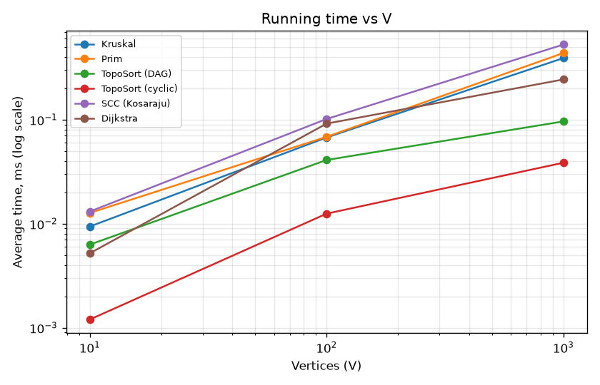
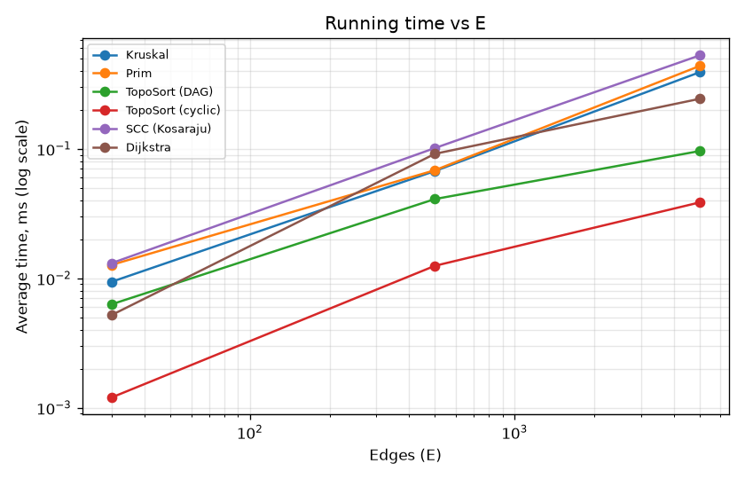

# Assignment 3 — Smart City Graph Algorithms

## 1. Overview

A city is modelled as a weighted graph:

- **vertices** are districts,
- **edges** are roads,
- **weights** are construction costs or travel distances (integers 1–100).

The project implements and compares:

| Task | Algorithms |
|---|---|
| 1. Minimum Spanning Tree (cheapest road network) | DSU, Kruskal, Prim |
| 2. Connectivity (one-way roads, dependencies) | Topological sort (Kahn), SCC (Kosaraju) |
| 3. Shortest paths (travel distance) | Dijkstra |

## 2. Project Structure

```
src/
  graph/          Edge, Graph (adjacency list), GraphGenerator
  dsu/            DSU (path compression + union by rank)
  mst/            Kruskal, Prim, MSTResult
  connectivity/   TopologicalSort, SCC
  shortestpath/   Dijkstra
  app/            Main (demo), Benchmark (experiments), Tests
results/
  tables/         results.csv, results.md, dsu.md
  plots/          time_vs_V.png, time_vs_E.png
plot.py           builds the plots from results.csv
```

## 3. How to Run

You need Java 17 or newer. No external libraries are used.

```bash
javac -d out $(find src -name "*.java")
java -cp out app.Main          # demo on a small city
java -cp out app.Tests         # tests
java -cp out app.Benchmark     # experiments -> results/tables/
python3 plot.py                # plots -> results/plots/ (needs matplotlib)
```

## 4. Implementation

**Graph.** An adjacency list (`List<List<Edge>>`) plus a flat list of edges. It supports both directed and undirected graphs. In an undirected graph each road is stored in both directions in the adjacency list but only once in the edge list.

**DSU.** Uses an array `parent[]` and an array `rank[]`.
- `find` uses **path compression**: after finding the root, every node on the path is pointed straight at the root.
- `union` uses **union by rank**: the shorter tree is attached under the taller one.
- Counters: `find` calls, `union` calls and parent steps.

**Kruskal.**
1. Sort the edges by weight.
2. Go through them in order and take an edge if `union(u, v)` succeeds, which means `u` and `v` were in different components.
3. Stop when `V-1` edges are taken.

If fewer than `V-1` edges are taken, the graph is disconnected.

**Prim.** Lazy Prim with `java.util.PriorityQueue` (a binary heap) holding edges.
- Take the lightest edge leading to a vertex not yet in the tree, add that vertex, and push its edges.
- Outdated heap entries are skipped.
- If the graph is disconnected, Prim restarts from the next unvisited vertex and reports `connected=false`. In that case it returns a minimum spanning forest.

**Topological sort (Kahn).**
1. Count the in-degree of every vertex and put all vertices with in-degree 0 in a queue.
2. Take vertices from the queue one by one, and decrease the in-degree of their neighbours.
3. If not every vertex gets taken, the graph has a **cycle** and the method returns `null`.

**SCC (Kosaraju).**
1. Run DFS on G and record vertices in order of finish time.
2. Run DFS on the reversed graph in decreasing finish time. Each DFS tree is one strongly connected component.

Both DFS passes are iterative, so the large graphs cannot overflow the stack.

**Dijkstra.** Uses a `PriorityQueue` of `(distance, vertex)` pairs with lazy deletion.
- `dist[]` holds distances and `prev[]` holds predecessors, which are used to rebuild paths.
- Unreachable vertices keep `dist = ∞` (`Long.MAX_VALUE`) and get an empty path.
- Negative weights are rejected with an exception.

**Why Dijkstra fails with negative weights.** When Dijkstra removes a vertex from the queue, it treats that vertex's distance as **final**. This is correct only if no later path can be shorter. With non-negative weights that holds, because any other path goes through a vertex that is already at least as far away. With a negative edge, a path that looks longer at first can become shorter later.

Example: edges `A→B = 2`, `A→C = 3`, `C→B = −2`.
1. Dijkstra fixes `B = 2` first.
2. The real shortest distance is `A→C→B = 1`, but B is never updated again.

For negative weights, Bellman-Ford should be used.

## 5. Complexity Analysis

Assumptions: adjacency list representation, binary heap (`PriorityQueue`), V vertices and E edges.

| Algorithm | Time | Extra memory | Reason |
|---|---|---|---|
| DSU `find` / `union` | O(α(V)) amortized, practically O(1) | O(V) | path compression + union by rank |
| Kruskal | O(E log E) = O(E log V) | O(V + E) | sorting dominates; E DSU operations cost O(E·α(V)) |
| Prim (binary heap) | O(E log V) | O(E) | each edge is pushed into and popped from the heap at most once |
| Topological sort (Kahn) | O(V + E) | O(V) | every vertex enters the queue once and every edge is examined once |
| SCC (Kosaraju) | O(V + E) | O(V + E) | two DFS passes plus the reversed graph |
| Dijkstra (binary heap) | O((V + E) log V) | O(V + E) | at most E heap insertions, each costing O(log V) |

Without the DSU optimizations a `find` can cost O(V), which makes Kruskal O(E·V) in the worst case. Section 7 shows this.

## 6. Experimental Setup

- **Graph sizes:** Small (V=10, E=30), Medium (V=100, E=500), Large (V=1000, E=5000).
- **Random seed:** `42` for all graphs, so the results are reproducible.
- **Generation rules:** weights are uniform in [1, 100], with no self-loops and no duplicate edges.
  - **Undirected (MST):** first a random spanning tree is built, by joining vertex `i` to a random earlier vertex. Then random edges are added until there are E edges. This guarantees the graph is connected.
  - **DAG (topological sort):** every edge goes from the smaller index to the larger one, so no cycle is possible.
  - **Cyclic directed (topological sort, SCC, Dijkstra):** random endpoints in a random direction. With E > V the graph almost always has cycles.
- **Timing:** `System.nanoTime()`. Each algorithm first runs 20 warm-up iterations, which are not measured, so the JIT compiler settles. Then it runs **5 times**, and the average is reported.
- **Machine:** MacBook Air (Apple M5), 16 GB RAM, macOS Tahoe 26.6, Java 27.
- **Operation counts:** edges examined, comparisons in sort and heap, DSU `find` and `union` calls, edge relaxations, and priority-queue operations.
- **Dijkstra source:** vertex 0.

## 7. Results

Raw data is in [`results/tables/results.csv`](results/tables/results.csv).

| Algorithm | Graph | V | E | Avg time (ms) | Operations | Details |
|---|---|---|---|---|---|---|
| Kruskal | Small | 10 | 30 | 0.0094 | 163 | weight=129; edgeExam=14; comparisons=107; dsuOps=42 |
| Prim | Small | 10 | 30 | 0.0127 | 263 | weight=129; edgeExam=60; comparisons=203 |
| TopoSort (DAG) | Small | 10 | 30 | 0.0063 | 30 | valid=true |
| TopoSort (cyclic) | Small | 10 | 30 | 0.0012 | 0 | cycleDetected=true |
| SCC (Kosaraju) | Small | 10 | 30 | 0.0131 | 60 | components=1; largest=10 |
| Dijkstra | Small | 10 | 30 | 0.0052 | 54 | relaxations=30; pqOps=24; reachable=10 |
| Kruskal | Medium | 100 | 500 | 0.0675 | 4483 | weight=1170; edgeExam=164; comparisons=3827; dsuOps=492 |
| Prim | Medium | 100 | 500 | 0.0685 | 8697 | weight=1170; edgeExam=1000; comparisons=7697 |
| TopoSort (DAG) | Medium | 100 | 500 | 0.0410 | 500 | valid=true |
| TopoSort (cyclic) | Medium | 100 | 500 | 0.0125 | 0 | cycleDetected=true |
| SCC (Kosaraju) | Medium | 100 | 500 | 0.1016 | 1000 | components=1; largest=100 |
| Dijkstra | Medium | 100 | 500 | 0.0917 | 800 | relaxations=500; pqOps=300; reachable=100 |
| Kruskal | Large | 1000 | 5000 | 0.3914 | 63793 | weight=13123; edgeExam=3356; comparisons=50369; dsuOps=10068 |
| Prim | Large | 1000 | 5000 | 0.4376 | 120958 | weight=13123; edgeExam=10000; comparisons=110958 |
| TopoSort (DAG) | Large | 1000 | 5000 | 0.0963 | 5000 | valid=true |
| TopoSort (cyclic) | Large | 1000 | 5000 | 0.0386 | 54 | cycleDetected=true |
| SCC (Kosaraju) | Large | 1000 | 5000 | 0.5280 | 10000 | components=18; largest=983 |
| Dijkstra | Large | 1000 | 5000 | 0.2439 | 7786 | relaxations=4946; pqOps=2840; reachable=990 |

**DSU: optimized vs naive** (worst case: a chain built by `union(i+1, i)`, then `find` on every vertex):

| n | Naive: parent steps | Optimized: parent steps | Naive time (ms) | Optimized time (ms) |
|---|---|---|---|---|
| 10 | 45 | 16 | 0.0032 | 0.0005 |
| 100 | 4950 | 196 | 0.0122 | 0.0045 |
| 1000 | 499500 | 1996 | 0.7982 | 0.0118 |

### Plots





## 8. Comparison and Discussion

- **Kruskal vs Prim.** Both give the **same MST weight** on every graph: 129, 1170 and 13123. The edge sets can differ when several edges have equal weight, because then more than one MST exists. Their running times are close, and both grow a little faster than linearly, as O(E log V) predicts.
  - **Kruskal** sorts all E edges, but thanks to DSU it stops early. On the Large graph it examined only 3356 of the 5000 sorted edges.
  - **Prim** looks at every adjacency entry (2E = 10000) and does more heap comparisons. On the Large graph Kruskal was slightly faster (0.39 ms vs 0.44 ms), but the difference is very small and close to measurement noise.
  - Kruskal is simpler for sparse graphs given as edge lists. Prim fits dense graphs and adjacency lists better.
- **DSU optimizations.** Without path compression and union by rank, the chain case costs n(n−1)/2 parent steps: 499,500 for n=1000. With them it costs about 2n steps. That is about 250 times fewer steps and about 68 times less time.
- **Topological sort.** The number of examined edges equals E exactly (30, 500, 5000), which confirms O(V+E).
  - On the cyclic graph Kahn stops almost immediately, because few or no vertices have in-degree 0. That is why its time is the lowest, and the method correctly reports a cycle.
- **SCC.** Each graph has exactly 2E edge examinations (two DFS passes). On the Large random graph there is one giant component of 983 vertices and 17 single-vertex components. These are vertices with no incoming or no outgoing roads.
- **Dijkstra.** It relaxed at most E edges, and its heap operations are close to V. The time grows close to linearly with a log factor. On the Large graph, 10 districts are unreachable from vertex 0, and they correctly get distance ∞.
- **Measurement note.** All times are under 2 ms, so small differences of a few hundredths of a millisecond are noise. Operation counts are the more reliable measure, and they match the theoretical bounds.

## 9. Testing

`app.Tests` contains **22 tests**, all of which pass. It is a simple test runner without external libraries.

| Case | What is checked |
|---|---|
| Small graph | known MST weight (6) for both Kruskal and Prim |
| Disconnected graph | both MST algorithms report `connected=false`, and the forest weights are equal |
| Multiple valid MSTs / duplicate weights | a square with all weights 1 gives weight 3 in both algorithms |
| Single vertex | MST weight 0, topological order of size 1, Dijkstra distance 0 |
| Random graphs | Kruskal and Prim give the same weight on 50 random connected graphs |
| Topological sort | the order is valid (every edge u→v has u before v) on 30 random DAGs |
| Cycle | `TopologicalSort.sort` returns `null` |
| SCC | the known components {0,1,2}, {3,4}, {5} are found; every vertex is in exactly one SCC; a DAG gives V components |
| Dijkstra | correct distances and path on a small example; the unreachable vertex has ∞ and an empty path; the result equals Bellman-Ford on 20 random graphs; negative weights are rejected |

## 10. Conclusion

All algorithms behave as their complexity analysis predicts.
- **MST:** Kruskal and Prim always agree on the weight. On these sparse graphs both scale as O(E log V).
- **DSU:** path compression and union by rank are essential. Without them DSU becomes quadratic in the worst case.
- **Topological sort and SCC:** both run in linear time O(V+E) and correctly detect cycles and strongly connected parts.
- **Dijkstra:** fast and correct for non-negative road lengths. It cannot be used with negative weights.

For a real city road network, Kruskal or Prim gives the cheapest set of roads connecting all districts. SCC shows which districts can reach each other through one-way streets, and Dijkstra gives the shortest routes.
